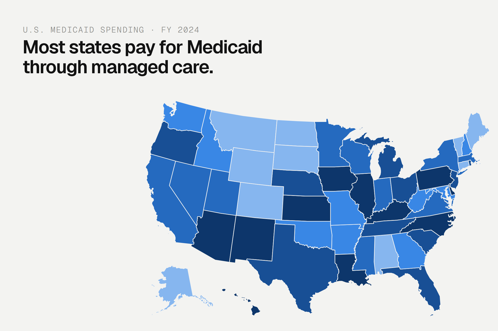

# Medicaid Spending Explorer

An interactive map of Medicaid spending by state and type of service for federal fiscal year 2024. Click a state to see its total, its share of national spending and a full breakdown by category.



## Features

- Choropleth map of all 50 states and D.C., colored by total spending or by any one category's share of a state's budget
- Pop-up summary on the selected state, with a full breakdown in the side table
- State list for jurisdictions too small to click reliably (Rhode Island, Delaware, D.C.)
- Keyboard navigation and a full data table for all 51 jurisdictions
- One self-contained HTML file with no external libraries or tracking

## Running it

Open `medicaid-spending-explorer.html` in any modern browser. No build step or server is needed.

The page loads the Geist and Geist Mono typefaces from Google Fonts. Offline, it falls back to system fonts.

To embed it on another site, host the file and load it in an iframe.

## Data

**Source:** KFF State Health Facts, ["Distribution of Medicaid Spending by Service"](https://www.kff.org/medicaid/state-indicator/distribution-of-medicaid-spending-by-service/), federal fiscal year 2024 (October 1, 2023 to September 30, 2024). KFF estimates based on CMS Form 64 data as of September 2025. Retrieved October 1, 2026.

`data/medicaid-spending-fy2024.csv` holds the figures used in the explorer, in U.S. dollars:

| Column | Description |
|---|---|
| `location` | State, District of Columbia or United States total |
| `ffs_acute_care` | Fee-for-service acute care: inpatient, physician, lab, X-ray, outpatient, clinic, prescription drugs, family planning, dental, vision, mental health and other practitioner services |
| `ffs_long_term_care` | Fee-for-service long-term care: nursing facilities, intermediate care facilities for people with intellectual disabilities, home health and personal care |
| `managed_care_and_health_plans` | Payments to HMOs, prepaid health plans and other health plans, plus primary care case management fees |
| `payments_to_medicare` | Mainly premiums Medicaid pays for people also enrolled in Medicare |
| `dsh_payments` | Disproportionate share hospital payments |
| `total` | Sum of the five categories |

**Coverage:** excludes administrative costs, accounting adjustments and U.S. territories.

**Negative values:** the figures include adjustments to spending in earlier years, so some categories are negative (five states report negative DSH payments in FY 2024). They are shown as reported, and no share is calculated for them.

**Reading the shares:** a low fee-for-service share usually means that care is paid through managed care plans instead, not that a state spends less on it.

## Method

- **Shares:** a category's spending divided by the state's total.
- **Color groups:** the 51 jurisdictions are split into fifths by the selected measure. Spending ranges from $767.5 million in Wyoming to $150.4 billion in California, so a linear scale would leave almost every state in the same color.
- **Color scale:** a single blue hue in five steps, checked for separation under color blindness and for contrast against the background.

## Findings (FY 2024)

- Managed care accounts for 53% of national Medicaid service spending and is the largest category in 36 of the 51 jurisdictions.
- It is under 5% of spending in eight states (Alabama, Alaska, Connecticut, Maine, Montana, South Dakota, Vermont, Wyoming) and 93% in Iowa.
- California and New York account for 26.8% of national spending; the five largest states account for 41%.
- In North Dakota and New Hampshire, fee-for-service long-term care is the largest category, at 55% and 40%.

## Built with

- HTML, CSS and JavaScript, with the map drawn as inline SVG
- State boundaries from [us-atlas](https://github.com/topojson/us-atlas) (derived from U.S. Census Bureau cartographic boundary files), simplified and converted to SVG paths

## Project structure

```
medicaid-spending-explorer.html   Interactive explorer
data/
  medicaid-spending-fy2024.csv    Source figures
images/
  medicaid-explorer-thumbnail.png Preview image
  medicaid-01-map-total.png       Map colored by total spending
  medicaid-02-managed-care-iowa.png  Managed care share, Iowa selected
  medicaid-03-mobile.png          Mobile view
```

## Disclaimer

Independent project using public data only. Not affiliated with or endorsed by KFF or CMS.

## Author

Alex Corvin, [alexcorvin.io](https://alexcorvin.io)
